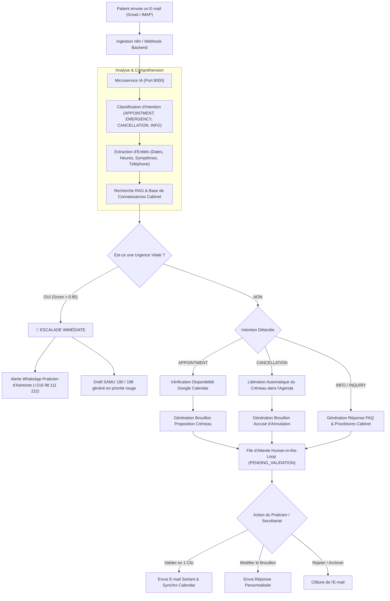
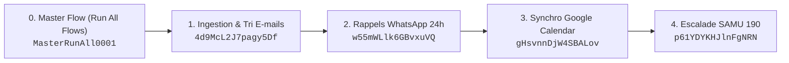

# Concept du Mailing, Logique des Réponses et Traitement IA

> **Document de Référence Fonctionnelle & Technique**  
> *Système Intelligent de Gestion des E-mails, Prise de Rendez-vous et Escalades d'Urgence pour Cabinet Médical*  
> **Dernière mise à jour :** Novembre 2026

---

## Table des Matières
1. [Vision Globale et Problématique Métier](#1-vision-globale-et-problématique-métier)
2. [Cycle de Vie d'un E-mail (Workflow End-to-End)](#2-cycle-de-vie-dun-e-mail-workflow-end-to-end)
3. [Ingestion des E-mails et Routage par Praticien](#3-ingestion-des-e-mails-et-routage-par-praticien)
4. [Moteur de Classification IA et Extraction d'Entités (NLP)](#4-moteur-de-classification-ia-et-extraction-dentités-nlp)
5. [Logique de Génération Intelligente des Réponses (RAG)](#5-logique-de-génération-intelligente-des-réponses-rag)
6. [Gestion des Rendez-vous & Synchronisation d'Agenda](#6-gestion-des-rendez-vous--synchronisation-dagenda)
7. [Approche Human-in-the-Loop (HITL) & Déontologie](#7-approche-human-in-the-loop-hitl--déontologie)
8. [Protocole d'Escalade d'Urgence Critique (SAMU 190)](#8-protocole-descalade-durgence-critique-samu-190)
9. [Orchestration Événementielle avec n8n](#9-orchestration-événementielle-avec-n8n)
10. [Matrice de Scénarios et Cas Concrets](#10-matrice-de-scénarios-et-cas-concrets)

---

## 1. Vision Globale et Problématique Métier

Dans un cabinet médical ou professionnel libéral, la boîte de réception e-mail reçoit quotidiennement des dizaines de messages hétérogènes :
* Demandes de rendez-vous de nouveaux patients ou de suivi.
* Demandes de reports ou d'annulations.
* Questions d'ordre administratif (devis, factures, horaires, coordonnées).
* Urgences médicales graves et vitales nécessitant une intervention immédiate.

### Le constat
1. **Surcharge cognitive du secrétariat** : perte de temps sur des réponses répétitives.
2. **Risque médico-légal critique** : un patient décrivant une douleur thoracique ou une détresse respiratoire peut rester non lu pendant plusieurs heures.
3. **Conflits d'agenda et double réservation** : erreurs manuelles lors de la saisie sur l'agenda Google Calendar ou papier.

### La solution MediLawAI
Une solution locale souveraine combinant :
* **Un modèle NLP Deep Learning** pour la détection fine des intentions et des entités.
* **Un moteur de réponse RAG** formulant des propositions médicales pertinentes.
* **Un orchestrateur n8n** automatisant la synchronisation avec Google Calendar et les alertes WhatsApp.
* **Une validation humaine (Human-in-the-Loop)** garantissant qu'aucune réponse ne part sans l'approbation finale du médecin ou de son secrétariat.

---

## 2. Cycle de Vie d'un E-mail (Workflow End-to-End)



---

## 3. Ingestion des E-mails et Routage par Praticien

### 3.1. Routage strict par boîte réceptrice (Mailbox Isolation)
Contrairement aux systèmes où tous les e-mails sont mélangés :
* **Chaque praticien possède son adresse Gmail dédiée** (ex: `rayen.9b7@gmail.com`).
* Le système route automatiquement l'e-mail vers le profil, les règles et l'agenda du médecin destinataire.
* Les identifiants OAuth2 (Google Client ID, Client Secret, Refresh Token) sont **chiffrés en base de données avec l'algorithme AES-256-GCM**.

### 3.2. Mécanisme de capture
Deux modes complémentaires sont disponibles :
1. **Webhook temps réel** : Déclenché instantanément par n8n ou le fournisseur d'e-mail dès l'arrivée d'un message (`POST /api/emails/ingest`).
2. **Polling résilient** : Vérification périodique toutes les minutes pour ne manquer aucun e-mail en cas de coupure réseau.

---

## 4. Moteur de Classification IA et Extraction d'Entités (NLP)

Le microservice IA (port 8000) analyse l'objet et le corps de l'e-mail à l'aide d'un modèle NLP de Deep Learning (architecture fine-tunée médical).

### 4.1. Les 4 Classes d'Intention (Intents)

| Intention | Description | Mots-clés Déclencheurs | Action Système |
| :--- | :--- | :--- | :--- |
| **`EMERGENCY`** | Risque vital aigu, arrêt cardiaque, douleur thoracique, détresse respiratoire. | *douleur thoracique, bras gauche, essoufflement aigu, inconscient, saignement abondant, malaise, paralysie, 190, urgence* | **Priorité Absolue** : Escalade WhatsApp praticien + consigne SAMU 190. |
| **`APPOINTMENT`** | Prise d'un nouveau rendez-vous ou demande de consultation. | *rdv, rendez-vous, consultation, créneau, disponible, horaire, voir le docteur, suivi cardiologie* | Analyse des disponibilités d'agenda + proposition de créneau. |
| **`CANCELLATION`** | Annulation ou demande de report d'un créneau déjà planifié. | *annuler, reporter, empêchement, indisponible, annulation, déplacer mon rdv* | Libération immédiate du créneau pour d'autres patients. |
| **`INFORMATION`** | Question générale, ordonnance, tarif, convention, documents. | *tarif, prix, honoraires, certificat, ordonnance, horaires d'ouverture, adresse, mutuelle* | Recherche dans la base de connaissances (RAG) + réponse FAQ. |

### 4.2. Extraction Nommée d'Entités (NER - Named Entity Recognition)
L'IA extrait automatiquement les informations clés de l'e-mail :
* **Date souhaitée** : ex. *"vendredi"*, *"demain"*, *"28 novembre"*.
* **Heure / Moment** : ex. *"10h"*, *"après-midi"*, *"matin"*.
* **Téléphone du patient** : ex. *`+216 98 456 789`*.
* **Symptômes / Motif clinique** : ex. *"palpitations à l'effort"*, *"contrôle tensionnel"*.
* **Score de confiance** : de `0.00` à `1.00` (ex: `0.96` = 96% de certitude).

---

## 5. Logique de Génération Intelligente des Réponses (RAG)

Une fois l'intention et les entités identifiées, le système applique un moteur de formulation RAG (*Retrieval-Augmented Generation*) respectant des règles déontologiques strictes :

### Règles d'Or Déontologiques
1. **Pas de diagnostic médical par e-mail** : L'IA ne prescrit jamais de traitement et ne formule aucun diagnostic définitif.
2. **Ton professionnel, bienveillant et clair** : Utilisation des formules de politesse adaptées au cadre médical ou juridique.
3. **Précision des démarches à suivre** : Chaque e-mail indique précisément ce que le patient doit faire pour confirmer son créneau.
4. **Signature institutionnelle systématique** : Inclut le nom du médecin, la spécialité, l'adresse du cabinet et le téléphone.

### Exemples de Réponses Générées

#### Cas 1 : Demande de Rendez-vous (APPOINTMENT)
```text
Bonjour M./Mme [Nom du Patient],

Nous avons bien reçu votre demande de consultation pour le motif suivant : [Motif].

Le Dr. Rayen B. dispose d'un créneau disponible ce [Date Extraite] à [Heure Proposée].

Pour confirmer ce rendez-vous, merci de bien vouloir répondre directement à cet e-mail par "OUI" ou de contacter notre secrétariat au +216 71 000 000.

Bien cordialement,
Secrétariat du Dr. Rayen B.
Cabinet de Cardiologie Interventionnelle & Médecine
```

#### Cas 2 : Urgence Vitale Détectée (EMERGENCY)
```text
🚨 ALERTE MÉDICALE IMPORTANTE :

Bonjour,
Votre message mentionne des symptômes évocateurs d'une possible urgence médicale aiguë. 

Par mesure de sécurité vitale, NE RESTEZ PAS SEUL(E) et CONTACTEZ SANS DÉLAI :
- Le SAMU Tunisie en composant le 190
- La Protection Civile en composant le 198
- Ou rendez-vous immédiatement au service des urgences le plus proche.

Notre praticien d'astreinte a également été alerté en priorité.

Cabinet Médical Dr. Rayen B.
```

---

## 6. Gestion des Rendez-vous & Synchronisation d'Agenda

### 6.1. Algorithme Anti Double-Booking (Anti Collision)
Pour éviter tout conflit entre deux patients réservant le même créneau :
* **Index unique MongoDB composé** : `{ clinicId: 1, practitionerId: 1, date: 1, "timeSlot.start": 1, status: 1 }`.
* Si une tentative de réservation survient sur un créneau déjà occupé, l'API Express renvoie un code `409 Conflict`.
* L'IA propose immédiatement le créneau disponible suivant le plus proche.

### 6.2. Sanctuarisation de la Pause Déjeuner (12h30 - 14h00)
* Aucun créneau n'est jamais proposé ni accepté entre **12h30 et 14h00**.
* L'algorithme saute automatiquement cette plage horaire pour protéger le temps de pause du médecin.

### 6.3. Synchronisation Bidirectionnelle Google Calendar
* **Création d'événement** : Lorsqu'un rendez-vous est confirmé, un événement Google Calendar est injecté avec l'ID du patient.
* **Marquage anti-boucle** : Pour éviter qu'une modification sur Google Calendar ne boucle indéfiniment avec le backend, chaque événement porte un tag d'origine `source: "medilaw-sync"`.
* **Libération en cas d'annulation** : L'annulation supprime ou libère le créneau en temps réel sur Google Calendar.

### 6.4. Rappels Automatiques 24h Avant Rendez-vous : Gmail Garanti & WhatsApp Optionnel
Le rappel automatique respecte une hiérarchie stricte des canaux :
* **Canal Prioritaire & Garanti (Gmail / E-mail)** :
  Chaque patient dont le rendez-vous a lieu le lendemain reçoit systématiquement un e-mail officiel de rappel comportant l'horaire précis, l'adresse du cabinet et la procédure de confirmation/annulation.
* **Canal Complémentaire & Optionnel (WhatsApp Business)** :
  WhatsApp est traité comme un canal de confort additionnel. **Si WhatsApp n'est pas configuré ou indisponible, cela ne pose aucun problème** : le système ignore gracieusement l'envoi WhatsApp (`status: OPTIONAL_SKIPPED`), consigne le rappel sans erreur, et le patient a de toute façon reçu son rappel par e-mail.

---

## 7. Approche Human-in-the-Loop (HITL) & Déontologie

Aucun e-mail patient ne doit être envoyé sans supervision lorsque l'enjeu médical ou juridique est présent.

```
[E-mail Entrant] ➔ [Analyse IA] ➔ [Génération Brouillon] ➔ 📋 FILE D'ATTENTE HITL
                                                                     │
                         ┌───────────────────────────────────────────┴───────────────────────────────────────────┐
                         ▼                                                                                       ▼
           [Option A : Validation Directe]                                                         [Option B : Édition Manuelle]
           - Clic sur "Valider & Envoyer"                                                          - Correction du texte ou du créneau
           - Envoi SMTP immédiat au patient                                                        - Validation personnalisée
           - Inscription dans l'agenda                                                             - Envoi immédiat
```

### Les 3 États d'un E-mail dans le Système :
1. **`PENDING_VALIDATION`** : Brouillon rédigé par l'IA en attente de validation par le médecin ou secrétaire.
2. **`VALIDATED_AND_SENT`** : E-mail validé par l'humain et transmis avec succès au patient.
3. **`ESCALATED_EMERGENCY`** : E-mail classé en urgence vitale, marqué d'un badge rouge clignotant et notifié sur WhatsApp.

---

## 8. Protocole d'Escalade d'Urgence Critique (SAMU 190)

Quand un patient exprime une détresse vitale par e-mail, chaque minute compte. Le protocole s'active en **moins de 2 secondes** :

1. **Détection** : L'IA identifie des termes comme *douleur thoracique*, *infarctus*, *étouffement*, *paralysie faciale*.
2. **Double Notification Instantanée** :
   * **Au Patient** : E-mail automatique immédiat avec consigne d'appeler le **190 (SAMU)** ou le **198 (Protection Civile)**.
   * **Au Praticien** : Notification prioritaire WhatsApp Cloud API envoyée au médecin d'astreinte (`+216 98 111 222`).
3. **Journalisation d'Audit** : Horodatage à la milliseconde pour traçabilité médico-légale (`AuditLog`).

---

## 9. Orchestration Événementielle avec n8n

Le moteur n8n (accessible sur `http://localhost:5678`) orchestre les flux sans aucune dépendance bloquante externe.

### Les 5 Workflows de Production :



1. **`MasterRunAll0001` (Master Orchestrateur)** : Déclenche en cascade les 4 flux et produit un bilan consolidé 4/4 succès.
2. **`4d9McL2J7pagy5Df` (Ingestion E-mails)** : Reçoit l'e-mail, appelle l'IA, classe l'intention et prépare le brouillon.
3. **`w55mWLlk6GBvxuVQ` (Rappels 24h)** : Cron quotidien à 08h00, extrait les RDV du lendemain et prépare les messages WhatsApp.
4. **`gHsvnnDjW4SBALov` (Synchro Calendar)** : Aligne l'agenda du Dr. Rayen B. en respectant 08:30-17:30 et la pause déjeuner.
5. **`p61YDYKHJlnFgNRN` (Escalade Urgence)** : Alerte SMS/WhatsApp immédiate au médecin de garde.

---

## 10. Matrice de Scénarios et Cas Concrets

| Cas | Objet & Contenu de l'E-mail | Intention IA | Brouillon & Action Système |
| :---: | :--- | :---: | :--- |
| **A** | *"Bonjour, je voudrais voir le docteur vendredi vers 10h pour un contrôle."* | `APPOINTMENT`<br>(96%) | **Brouillon RDV** : Propose vendredi 10h00, vérifie la disponibilité Google Calendar, place en `PENDING_VALIDATION`. |
| **B** | *"Au secours, mon père a une violente douleur dans la poitrine depuis 20 min."* | `EMERGENCY`<br>(99%) | **Escalade 190** : Alerte WhatsApp transmise au Dr. Rayen B. (+216 98 111 222), consigne SAMU 190 renvoyée. |
| **C** | *"Je ne pourrai pas venir à mon rendez-vous de demain 14h, désolé."* | `CANCELLATION`<br>(97%) | **Libération Créneau** : Annule le RDV dans l'agenda, libère la place pour un autre patient, accuse réception. |
| **D** | *"Bonjour, quel est le tarif pour une consultation avec électrocardiogramme ?"* | `INFORMATION`<br>(92%) | **Réponse FAQ RAG** : Présente les honoraires conventionnés du cabinet, les modalités de remboursement mutuelle. |

---

## Résumé des Commandes et Points d'Accès

* **Lancer l'ensemble des services** : Double-cliquer sur [`demarrer-tout.bat`](file:///c:/Users/AXELL/Desktop/Assistant-IA-de-gestion-des-e-mails-et-de-prise-de-rendez-vous/demarrer-tout.bat) ou exécuter `node scripts/runner.js`.
* **Interface Cabinet (Vite)** : [http://localhost:5173](http://localhost:5173)
* **Éditeur de Workflows n8n** : [http://localhost:5678](http://localhost:5678)
* **API Backend Express** : [http://localhost:5000](http://localhost:5000)
* **Microservice IA NLP** : [http://localhost:8000](http://localhost:8000)
